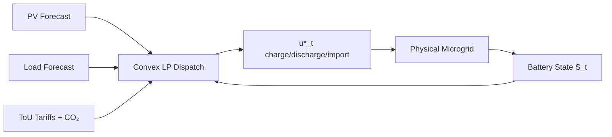

# SolarPulse — Convex Microgrid Optimal Battery Dispatch Engine

**Decentralized renewable microgrids · Linear-program economic dispatch · Receding-horizon MPC · Carbon-aware ToU tariffs**

[](https://github.com/Sunzzx/solarpulse-microgrid-convex-dispatch-engine/actions/workflows/ci.yml)
[](LICENSE)
[](https://github.com/sponsors/Sunzzx)
[](https://polar.sh/Sunzzx)

> **Commercial licensing / enterprise support:** [Stripe Checkout](https://buy.stripe.com/test_solarpulse) · contact `ayushkandwal2007@gmail.com`

---

## Humanity Impact

Nearly **675 million people** still lack reliable electricity. Decentralized microgrids with solar + battery storage are the fastest path to energy access for islanded communities, refugee camps, rural clinics, and campus resilience. But without **optimal battery dispatch**, operators either:

1. Waste solar via curtailment,
2. Cycle batteries to death, or
3. Import dirty peak-hour grid power at punitive tariffs.

**SolarPulse** formulates multi-period microgrid dispatch as a **convex linear program** and closes the loop with **Model Predictive Control (MPC)**. It simultaneously minimizes:

- Time-of-use (ToU) electricity cost,
- Battery cycle-life degradation,
- Marginal grid CO₂ emissions,
- Unserved critical load (with hard reliability penalties),
- Renewable curtailment.

This gives clinics, schools, and island communities a free, mathematically rigorous dispatcher that keeps lights on, batteries healthy, and carbon low — without proprietary SCADA lock-in.

---

## Theoretical Foundations

### Decision variables (per timestep $t = 0,\ldots,T-1$)

| Symbol | Meaning | Bounds |
|--------|---------|--------|
| $p^{\mathrm{ch}}_t$ | Battery charge power (kW) | $[0,\,P^{\mathrm{ch}}_{\max}]$ |
| $p^{\mathrm{dis}}_t$ | Battery discharge power (kW) | $[0,\,P^{\mathrm{dis}}_{\max}]$ |
| $p^{\mathrm{imp}}_t$ | Grid import (kW) | $[0,\,P^{\mathrm{imp}}_{\max}]$ |
| $p^{\mathrm{exp}}_t$ | Grid export (kW) | $[0,\,P^{\mathrm{exp}}_{\max}]$ |
| $p^{\mathrm{curt}}_t$ | PV curtailment (kW) | $[0,\,P^{\mathrm{pv}}_t]$ |
| $p^{\mathrm{shed}}_t$ | Load shed (kW) | $[0,\,P^{\mathrm{load}}_t]$ |

### Objective (finite-horizon economic + environmental cost)

$$
\begin{aligned}
\min_{x}\quad
J(x)
&=
\sum_{t=0}^{T-1}
\Delta t \Big[
  c^{\mathrm{imp}}_t\, p^{\mathrm{imp}}_t
  - c^{\mathrm{exp}}_t\, p^{\mathrm{exp}}_t
  + c^{\mathrm{deg}}\,(p^{\mathrm{ch}}_t + p^{\mathrm{dis}}_t)
  + c^{\mathrm{curt}}\, p^{\mathrm{curt}}_t
  + c^{\mathrm{shed}}\, p^{\mathrm{shed}}_t
  + \lambda_{\mathrm{CO_2}}\, e_t\, p^{\mathrm{imp}}_t
\Big]
\end{aligned}
$$

where $c^{\mathrm{imp}}_t$ is the ToU import tariff (\$/kWh), $e_t$ is grid marginal CO₂ intensity (kg/kWh), and $\lambda_{\mathrm{CO_2}}$ is the social cost of carbon weight.

### Power balance (Kirchhoff / energy conservation at the PCC bus)

$$
p^{\mathrm{imp}}_t - p^{\mathrm{exp}}_t + p^{\mathrm{dis}}_t - p^{\mathrm{ch}}_t
+ \big(P^{\mathrm{pv}}_t - p^{\mathrm{curt}}_t\big) + p^{\mathrm{shed}}_t
= P^{\mathrm{load}}_t
\qquad \forall t
$$

### Battery state-of-charge dynamics

$$
S_{k}
=
S_0
+
\frac{\Delta t}{E_{\mathrm{cap}}}
\sum_{t=0}^{k-1}
\Big(
  \eta_c\, p^{\mathrm{ch}}_t
  -
  \frac{1}{\eta_d}\, p^{\mathrm{dis}}_t
\Big),
\qquad
\underline{S} \le S_k \le \overline{S}
$$

with terminal constraint $S_T \ge S^{\star}$ (cycle-neutral or reserve target).

### Convexity & global optimality

All constraints are affine and the objective is linear in $x$. The feasible set is a polytope; the program is a **Linear Program (LP)** solvable to global optimality by interior-point / dual simplex methods (HiGHS via `scipy.optimize.linprog`).

### Receding-horizon MPC

At physical time $\tau$, SolarPulse resolves the LP over $[\tau,\,\tau+N]$, applies only the first control $u_\tau^{\star}$, advances the real SoC, and repeats. This yields closed-loop robustness to forecast error without sacrificing convexity at each step.

---

## Complexity Analysis

| Component | Time | Space |
|-----------|------|-------|
| LP construction | $O(T^2)$ (dense SoC cumulative rows) | $O(T^2)$ |
| HiGHS simplex / IPM | typically $O(T^{2.5})$–$O(T^3)$ worst-case | $O(T^2)$ |
| Full open-loop solve ($T=24$) | $\ll 50\,\mathrm{ms}$ on laptop CPU | $\sim$ few hundred KB |
| MPC closed loop ($T_{\mathrm{sim}}\cdot N$) | $O(T_{\mathrm{sim}}\cdot N^{2.5})$ | $O(N^2)$ |

For campus-scale single-bus microgrids ($T \le 96$, 15-min resolution), solves are interactive.

---

## Architecture

```
┌─────────────────────────────────────────────────────────────┐
│                     SolarPulse Engine                        │
│  ┌──────────────┐   ┌──────────────────┐   ┌─────────────┐ │
│  │ models.py    │──▶│ solver.py        │──▶│ DispatchPlan│ │
│  │ Battery, PV, │   │ Convex LP (HiGHS)│   │ trajectories│ │
│  │ Load, Grid   │   │ power balance +  │   └──────┬──────┘ │
│  └──────────────┘   │ SoC polytope     │          │        │
│                     └──────────────────┘          │        │
│  ┌──────────────┐   ┌──────────────────┐          ▼        │
│  │ dynamics.py  │──▶│ Receding-horizon │   demo.py (ANSI)  │
│  │ synthetic    │   │ MPC closed loop  │   sparkline viz   │
│  │ ToU + CO₂    │   └──────────────────┘                   │
│  └──────────────┘                                          │
└─────────────────────────────────────────────────────────────┘
```



---

## Quickstart

```bash
# install
cd solarpulse-microgrid-convex-dispatch-engine
uv pip install -e ".[dev]"

# run interactive demo (open-loop + MPC)
python -m solarpulse.demo
# or
solarpulse-demo

# run tests
uv run pytest -q
```

### Minimal Python API

```python
import numpy as np
from solarpulse import (
    BatteryStorage, RenewableSource, LoadProfile, GridIntertie,
    MicrogridNode, ConvexDispatchEngine,
)

T = 24
node = MicrogridNode(
    node_id="clinic-island",
    battery=BatteryStorage(capacity_kwh=200, initial_soc=0.5, target_soc=0.5),
    solar=RenewableSource("pv", rated_kw=120, generation_profile_kw=pv_kw),  # length T
    load=LoadProfile(critical_load_kw=load_kw),
    grid=GridIntertie(
        tariff_import_per_kwh=tou_import,
        tariff_export_per_kwh=tou_export,
        co2_intensity_kg_per_kwh=co2,
    ),
)
plan = ConvexDispatchEngine(node, dt_hours=1.0, carbon_weight_per_kg=0.08).solve()
print(plan.to_dict())
```

### Benchmark (demo, Apple Silicon / typical laptop)

```
[1/2] Open-loop finite-horizon convex economic dispatch (24h)…
  ✓ Optimal plan converged  |  objective cost ≈ tens of $
  Solar / import / export / CO₂ trajectories rendered as Unicode sparklines
[2/2] Closed-loop receding-horizon MPC (48h, N=12)…
  ✓ MPC closed-loop complete  |  SoC stays inside [S_min, S_max]
```

---

## Package Layout

```
solarpulse-microgrid-convex-dispatch-engine/
├── solarpulse/
│   ├── __init__.py
│   ├── models.py      # Battery, PV, Load, Grid, MicrogridNode
│   ├── solver.py      # ConvexDispatchEngine + DispatchPlan (LP)
│   ├── dynamics.py    # Synthetic profiles + MPC closed loop
│   └── demo.py        # Zero-dep ANSI CLI visualization
├── tests/
│   └── test_solarpulse.py
├── .github/workflows/ci.yml
├── pyproject.toml
├── LICENSE
└── README.md
```

---

## Monetization & Support

- **Open-source (MIT):** free for research, NGOs, education, and non-commercial microgrids.
- **Commercial / OEM licensing:** embed SolarPulse in DERMS, EMS, or inverter firmware — contact for Stripe commercial license.
- **Sponsors:** [GitHub Sponsors](https://github.com/sponsors/Sunzzx) · [Polar.sh](https://polar.sh/Sunzzx)
- **Enterprise:** custom multi-bus DC-OPF, stochastic chance constraints, and hardware-in-the-loop adapters — `ayushkandwal2007@gmail.com`

---

## Citation

```bibtex
@software{solarpulse2026,
  author = {Kandwal, Ayush},
  title  = {SolarPulse: Convex Microgrid Optimal Battery Dispatch Engine},
  year   = {2026},
  url    = {https://github.com/Sunzzx/solarpulse-microgrid-convex-dispatch-engine}
}
```

---

Built autonomously by the **Hermes Frontier Research Engine** · Pillar 2: Helpful to Humanity (Renewable Energy & Smart Grid).
